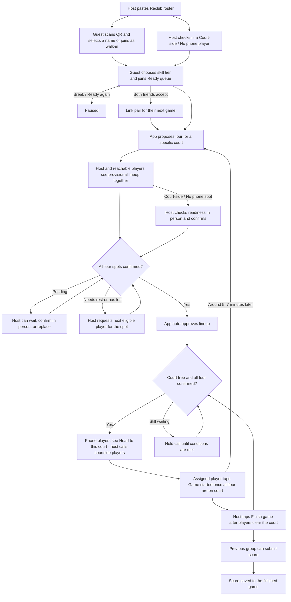

# Reclub roster to court to score · v1

Status: planned (v1 scope approved 2026-11-25)

Branch: `codex/reclub-to-court-v1`

## Goal

Help guests get more court time and help hosts keep courts moving. Reclub remains the source of sign-ups and payments. This app runs the social from arrival through game turnover and score entry. In a pilot with roughly 40–45 players and 4–6 courts, observe time from court release to next game start, player waits, and how often the host has to chase confirmations or fix a lineup.

## Scope

- Host pastes a roster of confirmed names into session setup. Guests use the shared check-in QR/link, pick their roster entry or join as a walk-in, choose Beginner, Intermediate, or Advanced, and enter the Ready queue as guests. No player account or download is required.
- Guests see how long they have been ready, their provisional or approved court assignment, and their current instruction. They can take a water break, return to Ready, or leave. Hosts manage court availability and use the venue's actual court labels.
- Pure Social doubles only. Prepare one On Deck group per court and support several courts preparing at once. The app approves when all four spots are confirmed. Any assigned player can start the game once the group is on court. The host finishes the game and releases the court.
- Two Ready players can mutually request to play together for their next game. The host can check in and confirm players who are courtside without a phone.
- Guests from a finished game and the host can enter its score after release. A game may remain unscored.
- Later scope: direct Reclub integration, persistent partner locks, alternative rotation modes, a dedicated TV display, profile claims, shareable recaps, kudos, and follows.

## Agreed flow

## Decisions and acceptance criteria

- **Roster and identity.** Import creates session roster entries, not ready players. Proposed v1 input is one name per line with a preview and ignored blank lines. Keep distinct same-name entries and always identify participants by ID. Reuse the existing guest device-cookie and check-in boundary, with a server-verified claim scoped to one participant in one session. Claiming a name from a list is self-identification. Prevent second claims and give the host a way to resolve an incorrect claim or duplicate name. Keep search results minimal and apply existing check-in privacy constraints to the public link. Concurrent claims must resolve atomically. Preserve approvals on existing check-in flows unless the new roster-enabled flow is selected.
- **Ready queue and matching.** Count active ready time, pausing accrual during a water break. Preserve previously earned wait when a player returns or a proposal is cancelled. For Pure Social, prioritize long waits, then use partner/opponent history and skill to choose and pair eligible players. Keep fairness preferences soft and record the proposed ordering/weights before implementation. A player can hold at most one On Deck spot and cannot be assigned while playing, paused, or left. Reuse existing scheduler and session metrics where they fit.
- **Friend pairs.** Two Ready participants must both agree before the scheduler treats them as a pair for their next game. Each player can hold one active pair request. Propose them on the same court when both are eligible, and consume the link when that game starts. If either player pauses, leaves, or is replaced before start, the host can clear the pair and fill the vacated spot without discarding other valid confirmations. Decide whether the pair implies the same team before finalizing the UI.
- **Court-side / No phone.** A host can add or check in a guest on their behalf and apply the tag during check-in or live play. Flag their spot for in-person confirmation. The tag does not count as readiness. When the court clears, the host relays the call in person. A group with no usable phone can be started by the host as a proposed fallback.
- **Preparation and timing.** On each occupied court, use actual game start time as the anchor. Proposed initial setting is six minutes, adjustable for the social. It triggers a readiness check, never an estimated finish or a court release. Publish one provisional state for the host and all four players to read. Allow manual preparation for a free court, including the first game, or an early readiness check for a game about to finish. Repeated polling, reloads, and two hosts must never produce duplicate proposals. A long game keeps its own On Deck group. Groups stay tied to the original court. When a court closes, cancel its pending lineup, alert affected guests in their session view, and return eligible guests to Ready with their accrued wait intact.
- **Confirmation and replacement.** Each proposed guest with a phone can answer Ready or Need a rest. The fourth confirmation automatically approves the current lineup. A reminder after 60 seconds is a proposed prompt for the host to check pending spots. Time alone never confirms a spot. No reply remains pending indefinitely until the host confirms in person or replaces the player. Replace asks the next eligible player to fill that one spot. The host can mark the outgoing player Left in the same action or pick a specific swap for a friends request. The other three keep their confirmations and the changed lineup is automatically approved once all four current spots are confirmed. Apply this even after the group was called and before game start. A guest reply tied to an old slot must not apply to its replacement. If nobody is eligible, show the vacant spot and keep the call pending.
- **Release, call and score.** Finish game releases a court immediately. When the court is free, all four are confirmed, and the current lineup is approved, show Head to Court with the venue label. These conditions can be met in either order. Any of the four assigned players can start the called game once the group is on court. Validate the current lineup, court availability, and caller membership server-side. Start retries and simultaneous taps must resolve to one match. Only the host can finish it. Score writes belong to the immutable finished match ID, independent of the current court occupant. Proposed v1 conflict policy is an idempotent first accepted submission, with host-only correction and clear feedback for a conflicting guest submission. Validate score input and team orientation server-side. Score writes never release or reserve a court.

## Build sequence

Work in phase order. Apply the existing server-only write ADR and social isolation. New action paths must verify the host or guest claim, enforce session scope at the database boundary, and preserve event IDs, sequence checks, and replay of old sessions.

### Phase 0 · Confirm the v1 design

Start here. Record the findings, proposed decisions, and any remaining questions in this plan. Confirm the open decisions with Ryan before implementing the affected application paths.

- [ ] **0.1 · Researcher:** Map event and recovery compatibility in `src/engine/session/{events,applyEvent,calledGroupHandlers,matchHandlers}.ts`, `src/server/submitSessionAction.ts`, and existing migrations. Confirm how to handle undo after a court call and how due proposals get generated when host tabs are inactive. Validate the delivery option on real player phones before committing to it.
- [ ] **0.2 · General:** Agree on host and player screens and update `DESIGN.md` after design approval. Use the existing compact host layout, 44 px tap targets, blue On Deck, lime go/play, orange attention, and text labels. Keep the player view mobile-first, light, and bilingual. Resolve notification delivery and roster claim recovery before building those UI paths.

### Phase 1 · Roster and guest access

- [x] **1.1 · Implementer:** Add paste and preview in `src/app/(host)/setup/`, using `src/server/setup/startSimpleSession.ts` and existing session participant storage where possible. Add parsing and setup tests.
- [x] **1.2 · Implementer:** Extend `src/server/checkin/{checkinActions,checkinDevice,checkinRules}.ts` and `src/app/t/[tag]/` for guest claims, walk-ins, skill tier, and a personal session view. Add host-assisted check-in and the Court-side / No phone tag. Add claim constraints in `supabase/migrations/` and integration coverage in `src/server/checkin/` and `supabase/tests/`.

### Phase 2 · Live lifecycle

- [x] **2.1 · Implementer:** Model Ready/Paused/Left, provisional court lineup, slot confirmations, automatic approval, call, and replacement in `src/engine/session/`. Extend `src/engine/schedule/simpleRecommend.ts` and its inputs for eligible groups, mutual next-game friend pairs, repeat history and skill. Keep time and randomness explicit. Verify first-game, early-finish and mid-session court-closure handling in replay.
- [x] **2.2 · Implementer:** Wire due proposals and host/guest actions through `src/server/submitSessionAction.ts` and `src/server/sessionLog.ts`. Add transactional functions in `supabase/migrations/`, regenerate database types, and test concurrent hosts, stale guest replies, simultaneous player starts, host-only finish and multi-court exclusivity. Publish state once, with a shared event timestamp for both audiences. Verify app restart and reconnect recover any due proposal safely.

### Phase 3 · Live views and post-game scoring

- [x] **3.1 · Implementer:** Extend `src/app/(host)/live/{LiveSession,LiveCourtCard,LiveWaiting,CourtRecovery}.tsx` with elapsed timers, provisional groups, pending slots, courtside confirmation, replacement and host finish. Extend `src/app/t/[tag]/` with wait, friend-pair requests, readiness replies, the current court instruction and assigned-player start. Translate both views under `src/i18n/messages/`.
- [x] **3.2 · Implementer:** Add a match-scoped score write and correction to the server and database, with player entry on the personal session view and host entry in the live UI. Test concurrent submissions and late score entry during a later game on the same court.

### Phase 4 · Verify the whole social

- [x] **4.1 · Implementer:** Add an `e2e/reclubToCourt.spec.ts` journey with a host and separate guest browsers. Cover import, walk-in, confirmation, substitution, friend pairing, no-phone confirmation, automatic approval, host finish, call, player start and delayed score entry. Cover two active courts finishing out of order and ensure their groups stay tied to their courts.
- [ ] **4.2 · General:** Run the app on phones and tablet. Rehearse a 40–45 player, 4–6 court social. Check that long waits, a court closure, a missed reply, and a mid-session departure are quick to handle. Record where the host loses time and how long courts sit empty.

## Draft decisions to resolve before the relevant phase

- **Player heads-up delivery.** The live screen is the source of truth. A foreground refresh using existing polling is enough to exercise the workflow locally. Decide how v1 reaches a player with their phone in their pocket and prove that option on the phones people bring. Resolve whether a continuously running server job is required for timed proposals.
- **Roster details.** Check a real anonymized Reclub paste sample, decide how ambiguous same-name claims are resolved, and approve the quick host recovery UI. Confirm whether the host should ever gate walk-ins for a full social.
- **Matchmaking and scoring.** Agree on how strongly wait wins when skill and repeat preferences conflict. Confirm allowed score formats and the proposed conflict/correction rule before score work.

## Phase 0 findings (2026-11-25)

Status: findings and recommendations recorded; D1–D12 all decided by Ryan; where a decision in the Log differs from a default in the table below or the baseline above, the Log wins. No application code, schema or deployment changed. Evidence labels: **[code]** read in the repository; **[ran]** exercised on the real engine with a temporary test, since deleted; **[docs]** vendor documentation read on 2026-11-25; **[untested]** needs a real phone or rehearsal.

`AGENTS.md` is stale: it describes weighted scoring with no hard rules and a membership-era `search_checkin_names`. `CLAUDE.md` and ADRs 0004/0005 match the code and were used here. Align `AGENTS.md` before another agent builds from it.

### What we can reuse

| Need                                | Existing piece                                                                                                               | Change needed                                                                                        |
| ----------------------------------- | ---------------------------------------------------------------------------------------------------------------------------- | ---------------------------------------------------------------------------------------------------- |
| On Deck group tied to a court       | `nextGroup` + `NextGroupCalled/Changed/Released`. Works while the court is busy **[ran]**                                    | Add slots, confirmations and replacement                                                             |
| One spot per player                 | `reservedCourtId` in the engine; per-session row lock and sequence check in SQL **[code]**                                   | Reuse unchanged                                                                                      |
| Vacated seat keeps the other three  | `invalidateCalledSeat`: rest or leave empties only that seat; the group cannot start with a gap **[ran]**                    | Add automatic refill request                                                                         |
| No duplicate preparation            | `autoPrepareCourts`, deterministic event ids **[code]**                                                                      | Plans free courts only; add due busy courts                                                          |
| Host-only finish, immediate release | `writeLiveAction` requires a host; `MatchCompleted` frees the court **[code]**                                               | Reuse                                                                                                |
| Court closure                       | `CourtClosed` clears the group; players return to waiting **[ran]**. Refused while a game is active (`COURT_BUSY`) **[ran]** | No host control exists on the live screen; see D11                                                   |
| Venue court labels                  | `CourtConfig.name` is free text **[code]**                                                                                   | Setup always generates "Court 1…N"; add label entry                                                  |
| Phone identity                      | Session cookie token; only its SHA-256 reaches SQL **[code]**                                                                | Bind it to one participant (claim)                                                                   |
| Wait, partner and opponent history  | `playerMetrics` **[code]**                                                                                                   | `simpleRecommend` uses wait, gender and mixed/same-sex streaks; skill and repeats are not used today |
| Open-page refresh                   | 5 s polling, stops while hidden, refreshes on return **[code]**                                                              | Host page has it; the player page stops polling once approved                                        |

### What the design must account for

1. **There are not always enough people for every On Deck group.** Six courts playing plus six On Deck groups needs 48 players. On the real scheduler, with everyone available **[ran]**:

   | Players  | Courts | On Deck groups possible |
   | -------- | ------ | ----------------------- |
   | 40       | 4      | 4                       |
   | 40 or 45 | 5      | 5                       |
   | 40       | 6      | 4                       |
   | 45       | 6      | 5                       |

   Breaks, gender mix, friend pairs and missing replies reduce this. Courts without a group must prepare when they free, including the four who just finished. Because groups stay tied to a court, a long game can strand four ready players while another court sits empty (D5).

2. **Simultaneous courts.** The engine and SQL already prevent double booking, but one sequence number covers the whole session. With 4–6 courts, guest replies will collide with each other and with host taps. Guest intents need a bounded server retry that re-checks the same slot. Do not show guests "updated by another host".
3. **Stale replies.** `NextGroupChanged` keeps the same `calledEventId` **[code]**, so that id cannot identify a reply. Each spot needs its own assignment id, new on every replacement. A confirmation must match group, assignment and claimed participant.
4. **Lineup changes after a call.** Derive "Head to Court" from court free + four current spots confirmed; never store it. A replacement, rest, departure or finish-undo then withdraws it automatically. Phones need an explicit "Change: wait" state, because someone may already be walking.
5. **Player start.** Several taps would send different match ids; the engine accepts only the first. Return "already started" to the others. Derive the match id from the group plus the start attempt, not the group alone: match ids cannot be reused after an undo **[code]**. Accept a start only for the current, fully confirmed lineup on a free court.
6. **Inactive host tabs.** Preparation runs only inside `readLiveSession`, which needs a signed-in host with a visible tab **[code]**. Recommendation: let authorised guest page reads run the same due check. The first read after the due time writes the group. If every screen is dark nobody could see a proposal anyway, so **no continuous server job is needed unless we choose push**. Use a deterministic id based on court and the match that became due, and record when it was actually published.
7. **Guest writes have no actor.** `append_session_event` requires a host and `actor_user_id` is mandatory **[code]**. Add a separate guest function that derives participant and session from the claim hash and permits only confirm, rest, return, leave, pair and start. Record guest and system actors truthfully rather than borrowing a host id. Session events are readable by hosts only, so guest reads need a narrow projection: own state, plus own group's names once assigned.
8. **A new policy version is required.** Engine rest is exactly ten minutes; an open-ended break is refused **[ran]**. Confirmations also change when a match may start. Use `simple-social-v2`; keep v1 replay and v1 sessions unchanged. New enum values need additive migrations.
9. **Roster entries cannot be today's participants.** `startSimpleSession` marks every stored participant present and requires gender and level **[code]**. Keep unclaimed names in a separate roster table; create the participant on claim or host check-in. First and last name are both required, so the import must handle single-word names.
10. **Wait preservation.** Rest keeps earned wait. Leave then rejoin starts a fresh wait **[code]**. A replaced non-responder stays the longest waiter and would be proposed again immediately unless paused (D10).
11. **Check-in rush.** Submissions are limited to 30 per network in 10 minutes **[code]**. Forty-five guests on one venue Wi-Fi would hit it; the local rehearsal hid this by giving each phone its own address. Set claim limits deliberately and test from one address.
12. **Polling load.** 45 open phones × every 5 s × 3 h ≈ 97,000 calls per social. Vercel's Hobby guideline is the first 1,000,000 invocations a month **[docs]**, about ten such socials before other traffic. Use a cheap version check first, and slower polling when nothing is pending.

### Undo

| Action                                            | Today                                           | Recommended for v2                                                    |
| ------------------------------------------------- | ----------------------------------------------- | --------------------------------------------------------------------- |
| Undo finish, different group On Deck              | Allowed; group kept **[ran]**                   | Keep. Call withdraws automatically; confirmations stay                |
| Undo finish, a finished player is already On Deck | Blocked until that group is released **[code]** | Keep blocked; name the group and offer Release                        |
| Undo finish, next game started on that court      | Blocked **[code]**                              | Keep; undo the newer start first                                      |
| Undo called start, no newer group                 | Restores the called group **[code]**            | Also restore confirmations and pair link                              |
| Undo called start after the 6-minute group exists | Blocked until that group is released **[code]** | Keep; never silently discard a newer group                            |
| Undo finish with a score entered                  | No scores yet                                   | Void the score, keep it in the audit, ask again after the real finish |

Guests never get Undo. Score submission stays outside the court-event sequence so it cannot conflict with release.

### Notifications: verified and unverified

| Question                            | Finding                                                                                                                                                    |
| ----------------------------------- | ---------------------------------------------------------------------------------------------------------------------------------------------------------- |
| Open visible page updates           | Existing 5 s polling **[code]**                                                                                                                            |
| Page hidden                         | Our polling stops **[code]**; browsers also throttle hidden timers **[docs, MDN]**                                                                         |
| Screen kept awake                   | Wake Lock needs a visible page and is released when hidden **[docs, MDN]**; battery cost **[untested]**                                                    |
| iPhone push                         | WebKit describes it for web apps added to the Home Screen, with permission requested by a tap **[docs]**. Guests installing this at arrival **[untested]** |
| Vibration                           | MDN lists limited availability; iPhone support not confirmed **[untested]**                                                                                |
| Timed server job on current hosting | Vercel Hobby cron: once a day, ±59 min, so unsuitable. Supabase Cron can run as often as every second and call HTTP **[docs]**; not configured here        |
| Push code                           | None exists: no service worker, manifest or push dependency **[code]**                                                                                     |

**Real-phone test before committing (Phase 0.1 remains open):** one recent iPhone and at least two Android makes people actually bring, on venue Wi-Fi and mobile data. For each: page visible; another app in front; screen locked 1, 5 and 10 minutes; browser closed; low-power mode; silent mode. Record delay until shown, time until noticed, and whether returning refreshes immediately. Also test: QR opened in Safari/Chrome versus in-app browsers (Reclub, Zalo, Facebook), and whether the claim survives switching between them. Push would need the same table plus install success rate and whether the installed app keeps the claim. An isolated prototype needs Ryan's approval; nothing here was sent to a phone.

### Decisions for Ryan

| #       | Decision                                                                                  | Trade-off                                                                                                                                                                                                     | Recommended default                                                                                                                                                                                                                                                                                                 |
| ------- | ----------------------------------------------------------------------------------------- | ------------------------------------------------------------------------------------------------------------------------------------------------------------------------------------------------------------- | ------------------------------------------------------------------------------------------------------------------------------------------------------------------------------------------------------------------------------------------------------------------------------------------------------------------- |
| **D1**  | How does a player with a pocketed phone find out?                                         | Open page only: simple, but silent phones stall the four-confirmation gate and the host chases. Push: may reach locked phones; needs iPhone Home Screen install, permission, a server timer and phone testing | Open page for v1 with a full-screen alert and optional keep-awake; host calls anyone unconfirmed after 60 s and confirms in person. Measure chasing in the rehearsal, then decide on push                                                                                                                           |
| **D2**  | Claiming and recovering a name                                                            | Self-claim is fast but someone can take the wrong name. Host approval is safer but rebuilds the arrival queue. A PIN is stronger and slower                                                                   | Self-claim, one phone per entry. "That's my name" on a taken entry asks the host; the host sees check-in time and either moves the claim (old phone loses access at once) or keeps it. Identical names: show "Minh Tran (1 of 2)"; add the host's short note to tell them apart. Lost cookies use the same recovery |
| **D3**  | Gender rule. The flow asks only for skill, but every valid lineup today needs male/female | Keep it: familiar mixed/same-sex games, one more question. Drop it: any four play, more flexible replacements, changes ADR 0005                                                                               | Keep the rule and ask gender at claim. Reclub paste contains names only                                                                                                                                                                                                                                             |
| **D4**  | Friend pair: same court or same team, and whose wait counts?                              | Same team forces same-sex pairs into an all-men or all-women game. Using the longer wait lets a friend jump the queue                                                                                         | Same court, either side; team preference when valid. Use the shorter of the two waits. Link lasts one started game; undo start restores it                                                                                                                                                                          |
| **D5**  | Ready group stranded behind a long game                                                   | Strict tie is clear but leaves an empty court. Moving the group uses courts better but changes what players were told                                                                                         | Keep the agreed tie. Empty court prepares from everyone Ready; host may Release a stranded group. Never move automatically. Measure it                                                                                                                                                                              |
| **D6**  | Do walk-ins need approval?                                                                | Open entry is fast but anyone with the link joins and may bypass payment                                                                                                                                      | Roster claims enter directly; walk-ins need one host tap. Host can close walk-ins when full                                                                                                                                                                                                                         |
| **D7**  | How strongly wait beats skill and variety                                                 | More balance means someone waits longer. Skill tiers are self-reported                                                                                                                                        | Wait picks the four; repeats then skill only arrange teams within them. No player passed over for balance. Friend pairs and valid gender are the exceptions                                                                                                                                                         |
| **D8**  | Score format and conflicts                                                                | Strict rules catch mistakes but reject house formats                                                                                                                                                          | Two whole numbers, 0–99, no tie, one score per game. First accepted stands; identical repeats succeed; different ones say "already recorded" and only a host corrects                                                                                                                                               |
| **D9**  | Replacement: ask automatically or after a host tap?                                       | Automatic is faster; a wrong tap reshuffles people                                                                                                                                                            | Need a rest, break or Left: ask the next valid player automatically. No reply: host decides, as agreed. No valid candidate: leave the spot visibly open                                                                                                                                                             |
| **D10** | Break length, leaving, replaced non-responders                                            | Open-ended breaks get forgotten. Keeping wait after leaving rewards absence                                                                                                                                   | Break until they tap Ready, reminder at 10 min, wait frozen. Left then return starts fresh. Replaced for no reply: Paused, wait frozen, until they or the host say Ready                                                                                                                                            |
| **D11** | Closing a court mid-game (as happened on 21 Nov)                                          | Forcing it ends a game; waiting may not suit the venue                                                                                                                                                        | Two choices: "Close after this game" (cancel On Deck now) or "Stop game and close" (no completed game recorded). Same screen can reopen it                                                                                                                                                                          |
| **D12** | Automatic six-minute readiness check                                                      | Early asks bother people; late asks leave courts empty                                                                                                                                                        | Six minutes, host-adjustable. If not enough players, prepare the oldest-running courts first                                                                                                                                                                                                                        |

Recommended build change after approval: split Phase 2.1 so engine policy v2 and its replay tests land before friend pairs and skill. Scope is unchanged.

### Phase 0 status

- **0.1:** compatibility, undo and inactive-tab analysis done. Real-phone delivery test **not done**.
- **0.2:** not started; screens can start once the remaining decisions that affect them are made. A real anonymised Reclub paste sample is still needed.

## Test plan

- Run lint, typecheck, format check, Vitest, pgTAP against local Supabase, production build and Playwright. Run the app and verify English/Vietnamese on real mobile browsers.
- Unit and replay tests cover historical sessions, timer boundaries, preserved wait, pause and exit, swaps, stale confirmations, pair eligibility and expiry, no-phone spots staying pending until confirmed, replacement with no candidates, release before/after approval, and undo dependency cases.
- Database/integration tests cover double claims, wrong-session access, expired or missing guest claim, participant-only score writes, repeated requests, concurrent hosts, unauthorized game starts and finishes, duplicate start taps, and simultaneous proposals for the same candidate.
- Review both normal and exception paths at 4–6 active courts. Measure delivery delay and time from release to next start in the rehearsal.

## Release safety

Rehearse additive migrations and rollback using local Supabase with representative existing sessions. Before any approved production release, take and verify a restorable backup, document the compatible app rollback and schema/data recovery path, and verify check-in, court turnover, and delayed scores after release. Obtain explicit approval before production migration or deployment.

## Log

- 2026-11-25 · Ryan approved the v1 plan and cleared Phase 0 to start.
- 2026-11-25 · Phase 0 findings and decisions D1–D12 recorded. Real-phone tests and Ryan's decisions outstanding. Phase 1 not started.
- 2026-11-25 · **D1 decided (Ryan):** v1 has no push. Players see calls on the open page; the host calls anyone else over in person. No continuous server job is needed. Phone checks still needed: refresh on return, in-app browsers and claim survival. Push tests are deferred until the rehearsal shows how much chasing remains.
- 2026-11-25 · **D2 decided (Ryan):** guests claim a roster name themselves, with no host approval. The recovery flow shown with the question (one phone per name, "That's my name" goes to the host, numbered identical names) is the working default; Ryan sees it again at screen review.
- 2026-11-25 · **D3 decided (Ryan):** keep the valid-doubles gender rule (ADR 0005 unchanged). Guests choose male or female with their level when they claim a name or join as a walk-in.
- 2026-11-25 · **D4 partly decided (Ryan):** a friend pair means the same **team** for one game. This replaces the same-court recommendation above. With D3, two men need an all-men game and two women an all-women game; a man and a woman partner in a mixed game. The pair must be placed on one team or not at all. Still open: whose wait counts. Friends who want to play against each other are not covered by pairs; the host can arrange that with a specific swap.
- 2026-11-25 · **D4 complete (Ryan):** a pair is ranked by the shorter of its two waits. Each player's own earned wait is kept underneath, so cancelling the pair restores their place.
- 2026-11-25 · **D5 decided (Ryan):** groups stay tied to their court unless the **host** moves one to another open court with no game in progress. The app never moves a group by itself. Amends the "Groups stay tied to the original court" baseline. Working default, to confirm at screen review: confirmations and wait move with the group, and phones show the new court. An empty court is prepared automatically within seconds, so the target will often already have a group: the two groups then swap courts, each keeping its confirmations. Needs one atomic move/swap event with undo rules; a start tap for the old court must be refused.
- 2026-11-25 · **D6 decided (Ryan):** walk-ins wait for one host tap to approve, reusing today's check-in requests. Roster claims still go straight in (D2). Closing walk-ins when the social is full is the working default.
- 2026-11-25 · **D7 decided (Ryan):** wait always wins in v1. The longest-waiting players who make a valid game are chosen; repeats, then skill, only arrange teams within the four. Exceptions: the gender rule, friend pairs (D4) and host choices.
- 2026-11-25 · **D8 decided (Ryan):** one score per game, two whole numbers 0–99, no ties. Any of the four or the host enters it after finish; optional. First stands, identical repeats succeed, a different one says "already recorded", only the host corrects. Undoing the finish cancels the score.
- 2026-11-25 · **D9 decided (Ryan):** Need a rest, break or leave fills that spot automatically with the next valid player; the other three keep their confirmations. No reply stays pending for the host. With no valid player the spot stays visibly open. Working defaults, to confirm at screen review: an "Are you sure?" before giving up a spot; and if one of a friend pair drops out, the pair ends by itself and the other keeps their spot (the baseline has the host clear it).
- 2026-11-25 · **D10 decided (Ryan):** a break lasts until the player taps Ready (or the host brings them back), with a page reminder at 10 minutes; earned wait is kept and frozen. Leaving then returning starts a new wait. A player replaced for no reply is Paused with wait frozen until they or the host tap Ready. Replaces the fixed ten-minute rest of ADR 0005 for `simple-social-v2` only.
- 2026-11-25 · **D11 decided (Ryan):** host can "Close after this game" (On Deck group returns to Ready at once, wait kept) or "Stop game and close" (interrupted, no score, no completed game). Players from a stopped game start a new wait from zero, as today. A free court just closes; reopening is in the same place. "Close after this game" needs a new pending-close state: the engine refuses to close a busy court today.
- 2026-11-25 · **D12 decided (Ryan):** readiness check six minutes after the actual game start, host-adjustable per social. When players are short, the court whose game started first gets its group first. Early finishes prepare when the court frees; the host can ask sooner.
- 2026-11-25 · All Phase 0 decisions made. Still open in Phase 0: a Reclub CSV sample and the import questions below, real-phone checks (refresh on return, in-app browsers, claim survival), host and player screens (0.2), and correcting `AGENTS.md`. Phase 1 not started; awaiting Ryan's approval.
- 2026-11-25 · **Reclub text sample (Ryan's draft; confirm it matches a real copy).** Names not copied here. Structure: title, date and venue lines starting with emoji; `Confirmed (10/16)`; numbered `N. First Last` lines; suffixes `(+1)` and `(Host)`; then `Waitlist (3)` with its own numbering. Ten confirmed lines plus one `(+1)`, so the count either excludes the guest or the draft is approximate. No gender, level or ID. Effect: "one name per line, ignore blank lines" is not enough. Recommended: read only the Confirmed section; strip numbering; treat known suffixes as flags, never as part of the name; leave anything unrecognised in the preview for the host to fix; still accept a plain list of names. First word is the first name and the rest the last; single-word names are flagged. Text paste is the v1 path; CSV also exists, columns unknown. If CSV is used, keep names only and discard contact details. Open: how to treat `(+1)`, `(Host)` and the waitlist.
- 2026-11-25 · **Import: `(+1)` decided (Ryan):** creates a second roster entry shown as "Guest of <name>". The guest claims it, enters their own name, gender and level, and needs no host approval. Working default: `(+2)` creates two numbered entries. Still open: `(Host)` and the waitlist.
- 2026-11-25 · **Import: `(Host)` decided (Ryan):** imported like everyone else with the tag removed from the name. They join Ready only by claiming or host check-in; host access stays separate and the tag grants none. Still open: the waitlist.
- 2026-11-25 · **Import: waitlist decided (Ryan):** not imported. Working defaults, to confirm at screen review: pasting again adds only new names, never removes or resets anyone, and shows names missing from the new paste for the host to decide. Matching a re-paste relies on names, so identical names and claimed "Guest of" entries need a preview check. Import decisions are complete for text; the CSV sample is optional.
- 2026-11-25 · **0.2 drafted:** 31 host and player phone mockups in `docs/designs/reclub-to-court/review.html`, awaiting Ryan's review. Working defaults are labelled "Choice to confirm". Dark theme, tablet and most Vietnamese screens are not drawn. `DESIGN.md` changes only after approval.
- 2026-11-26 · **0.2 review (Ryan):** 29 of 31 screens approved as drawn, including every "Choice to confirm" except h7's. Changes asked: (1) h2: single-word names are common on Reclub, so accept them as they are; every imported line gets its own UUID; a name that appears twice is shown numbered, "(1)" and "(2)", with an optional host note, and a taken twin greys out ("In use") in player search (p1 updated to match; this tells others that one of the two has arrived, which is accepted). (2) h7: say "Up next", not "On Deck", everywhere; keep Live courts compact for 5 to 10 courts (short card per court, Up next inside it, a "Call over" list at the top). h2, h7 and p1 redrawn and sent back for review.
- 2026-11-26 · **0.2 approved (Ryan):** all 31 screens, including the redrawn h2, h7 and p1 and h7's "host can also tap Start game". Summary recorded in `DESIGN.md` ("Reclub to court"). Phase 0 design step done; Phase 1 still waits for Ryan's explicit approval.
- 2026-11-26 · **Phase 1 built (Ryan approved the start).** Branch `codex/reclub-to-court-v1`. Migration `20261126090000_reclub_roster.sql` (additive): `session_roster_entries`, `roster_transfer_requests`, `sessions.walk_ins_open`, `session_events.actor_session_participant_id` (a player's own check-in is recorded as theirs; `actor_user_id` now nullable, exactly one actor), `session_participants.last_name` may be empty (one-word Reclub names), new `claim` rate-limit kind (400 per network per 10 min, for one venue Wi-Fi). Host: new **Arrivals** page (`/arrivals`, nav between Setup and Live) with paste → check names → add (h1-h3), "That's my name" Move/Keep (h5), Not arrived with host check-in for no-phone players (h6), notes for same-name entries, Close/Open walk-ins, and an Arrived list. Player: Find your name (p1), details with guest name (p2), name in use → That's my name → waiting (p3), walk-ins closed, and a simple "You're in" (the Ready/Up next views come in Phase 3). Checks: lint, typecheck, 995 Vitest (incl. 8 new roster integration tests on local Supabase), 561 pgTAP (new `15_reclub_roster`), production build, new e2e `reclubRoster.spec.ts` passes. **Differences from the drafts:** walk-in approvals stay in the existing Check-ins tray on Setup and Live (Arrivals links to it) instead of moving into Needs you; same-name notes are added on the list after import rather than in the preview; court labels and the six-minute setting (h4) wait for Phase 2. **Known flake, not from this branch:** `liveEdgeCases.spec.ts:476` loses an add to a sequence race under heavy parallel load; it fails the same way on `main` (11 of 16 runs at 6 workers). Nothing deployed; no hosted migration applied.
- 2026-11-26 · **Phase 2 slices 1-2 built (Ryan approved the start).** Slice 1 (commit 33953a9): engine policy `simple-social-v2` with Up next confirmations, open breaks with a reason and frozen wait (D10), host move/swap (D5), "Close after this game" with undo (D11), due courts by the timer, free court first then the oldest game (D12), and automatic refill of an emptied seat with the longest-waiting valid player (D9); v1 replays unchanged. Migration `20261126120000_simple_social_v2.sql` (new event types; an automatic action may have no person as actor). Slice 2: new sessions start as v2 with a 6-minute timer; the app's own actions (close, refill, ask the next four) run one at a time from any host read and after any player action, recorded as the system; player taps (I'm ready, Need a rest, Ready again, I'm leaving, Game started) from the check-in page, where the server works out the action, retries on a race, and several Game started taps make one game; host commands for confirm in person, pause for no reply, move, close after game, close now, and undo of a close. Migration `20261126130000_player_and_system_actions.sql` (`append_session_event_without_host` lets a player act only for themselves and the system only prepare/refill/close). Checks: 1,016 Vitest incl. new v2 engine, planner and player-action integration tests; 561 pgTAP; e2e 71/72 (only the known `liveEdgeCases.spec.ts:476` flake). The existing live screen keeps working on v2; the v2 views (Up next confirmations, Call over, player Ready/Up next/Head to court) are Phase 3. Still to do in Phase 2: friend pairs (D4) and arranging teams by repeats then skill within the chosen four (D7).
- 2026-11-26 · **Phase 2 done (slice 3: friend pairs and teams).** Friend pairs (D4): `FriendPairRequested` / `FriendPairAccepted` / `FriendPairEnded` (migration `20261126140000_friend_pairs.sql`); both must be Ready and unpaired; the pair waits as one unit ranked by the shorter of the two waits and is kept on one team; a start uses it up (undo restores it); a break or leaving ends it and the friend keeps their place (p14); a refill never splits a pair. Teams (D7, v2 only): wait picks the four, then the split with the fewest repeat partnerships, then the closest skill. Player taps: Ask a friend, Team up, No thanks/cancel; host command End pair. Checks: lint, typecheck, 1,021 Vitest, 561 pgTAP, bench, build, e2e 71/72 (only the known `liveEdgeCases.spec.ts:476` flake). Nothing deployed; the three Phase 2 migrations exist only on the local database. Next: Phase 3 (live views for hosts and players, and scores) after Ryan's approval.
- 2026-11-26 · **Phase 3 built (Ryan approved the start).** Part 1 (c7b8804): the player's live page on the check-in link once the social is live: Ready with wait, Up next with I'm ready / Need a rest ("Give up this spot?"), who has confirmed, Change notices, Head to court with Game started, playing, break and no-reply pause with the 10-minute reminder, leaving ("Leave for today?"), moved-court and friend-dropped notices, friend pairs (search Ready players, ask, team up, cancel); polls every 5 s while visible and runs the app's due actions, so preparation never waits for a host's screen. Part 2 (d5b1576): host live screen for v2: confirmations per Up next group in one line, per-seat options once a reply is a minute overdue (Confirm in person, Replace with next player, Replace and mark as left), Call over list, court options (move/swap, close after this game, stop game and close, close now, reopen), waiting list with Break / Paused (reason and time), no-phone and friend pair labels with End pair. Part 3: scores (D8) — migration `20261126150000_match_scores.sql` (one standing score per game, 0-99, no tie; first stands, same again is fine, different is "already recorded"; host corrects; undoing the finish voids it); player score card after a game in any state but playing; host Recent games with Add score / Correct. **Differences from the drafts:** per-seat options appear after a minute without a reply (keeps 5-10 courts compact); the score card also shows while Up next (small socials call the same four again at once). Checks: lint, typecheck, build, 1,026 Vitest, all pgTAP (new 16_match_scores), e2e 72/73 (only the known `liveEdgeCases.spec.ts:476` flake). Nothing deployed; five migrations (20261126090000-150000) are local only. Next: Phase 4 (end-to-end journey across two courts, rehearsal) after Ryan's approval.
- 2026-11-26 · **Phase 4 (Ryan approved the start).** 4.1: `e2e/reclubToCourt.spec.ts` runs a whole social with a separate browser per guest (import, walk-in, no-phone check-in, friend pair, a rest refilled, confirmations, two courts finishing out of order, groups tied to courts, phone and host starts, a score added after the next game began). Found and fixed: a no-phone player could be confirmed only after a minute. 4.2 simulation (`src/server/live/rehearsal.test.ts`; `REHEARSAL_REPORT=1` prints it): 42 players, 5 courts (one closed at 90 min), 3 hours, three seeds: 61-62 games; court idle between games median 60-75 s, 90th percentile 95-115 s; longest wait 27-39 min; 4-8 games each; 71-78 host taps (about one every 2.5 minutes, mostly Game finished); automatic planning 3 ms at most, friend-pair worst case 0.4 s. The reply, no-reply, break and game-length rates are assumptions, not measurements. Found and fixed: each phone refresh re-read the whole log (about 10 GB of database traffic per social); the server now fetches only new events per warm instance. Checks: lint, typecheck, build, 1,027 Vitest, pgTAP, e2e 74/74. **Not done:** the real-phone rehearsal (below); dark and tablet review of the new screens; Vietnamese native check. **Not built, deferred without saying so earlier:** venue court labels and the adjustable six-minute setting (screen h4).

### Real-phone checklist (Ryan, before a pilot)

- One iPhone and two Androids on venue Wi-Fi and mobile data: scan the QR, claim a name, lock the phone for 5 minutes, return; the page should update at once.
- Open the link from inside Reclub, Zalo and Facebook; check the claim survives, or note which one loses it.
- Two courts with eight or more people: note how long a court sits empty, who you had to chase, and any screen that confused someone.
- Check the host screen on a tablet in bright light.
- 2026-11-26 · **h4 built (Ryan asked):** setup has a name field per court (venue labels, must differ; first 40 courts) and "Ask the next four" minutes (1-30, default 6). No migration: both live in the draft config. Generated "Court N" names still follow the language; the player page now translates them too (it showed English before). Checks: lint, typecheck, build, 1,028 Vitest, e2e 72/74 (the known `liveEdgeCases.spec.ts:476` flake in both browsers; `setup.spec.ts:179` failed once and passed on reruns). **Open finding:** a host tap made while a player's reply is being saved is refused as "updated by another host" (seen in `reclubToCourt.spec.ts`, which now waits). With 45 phones this is likely to be noticeable; recommended fix: retry host actions whose target is unchanged.
- 2026-11-26 · **Host tap collisions fixed (Ryan approved).** `src/server/live/hostTapStillApplies.ts`: a host's tap from a slightly old screen applies to the latest log when everything since was a player's or the app's own action and what they tapped is unchanged (confirmations don't change a lineup); another host's action is still a conflict; undo is never carried over. Writes retry up to three times if another event lands mid-write. Adding a player and approving a walk-in ignore player and app events the same way. Also fixed: "Stop game and close" reported success even if the close failed. Checks: lint, typecheck, build, 1,030 Vitest, e2e 74/74, whole-social journey 6/6 in parallel without its earlier wait. `liveEdgeCases.spec.ts:476` still fails under heavy parallel load (v1 fixture: preparation is recorded as a host action).
- 2026-11-26 · **Deployed to the pilot (Ryan approved `576b78f`).** See `reclub-to-court-deploy.md`. Real-phone checklist outstanding.
- 2026-11-26 · **One setup page (Ryan asked while testing):** the Arrivals page and menu item are removed; its section is on Session setup (with Show QR code) and under Check-ins on Live courts. Setup shows the walk-in box only while a request waits. Setup now re-reads players when someone checks in from the list, so Start session enables without a reload (before, it did not). Not deployed.
- 2026-11-26 · **Deployed `4af54f2` to the pilot (Ryan approved):** app only, no migrations; deployment `pickleball-pilot-qm8autyp1`; rollback to `pickleball-pilot-goyi72coc`. Sign-in and check-in pages load; not checked signed in.
- 2026-11-26 · **Up next fully automatic (Ryan, while testing; changes D12's six minutes).** Default `upNextAfterMinutes` is 0: next four lined up as soon as a game starts. v2 live screen drops Prepare next four, Call these four and Release group. Undo of a start or finish releases the groups in its way first. Courts held by a release are freed by an undo. Sessions already started keep their own setting. Checks: lint, typecheck, build, 1,030 Vitest, e2e 74/74. Not deployed. Watch: with early lineups hosts see no-reply flags while courts are busy; with few players the four who finish are called straight back, hiding their phone's score card (host can add it).
- 2026-11-26 · **Deployed `9ab198e` to the pilot (Ryan approved):** app only; deployment `pickleball-pilot-60slgffip`; rollback to `pickleball-pilot-qm8autyp1` (end sessions started with "Straight away" first).
- 2026-11-26 · **Fixed (found in Ryan's test):** a phone opened before the list was pasted stayed on the walk-in form, with Find your name only as a bottom button. It now moves to Find your name within about 10 s, and Try again after a rejection does too. 1,031 Vitest, e2e 72/74 (known flake only). Not deployed.
- 2026-11-26 · **Deployed `e7475e6` to the pilot (Ryan approved):** app only; deployment `pickleball-pilot-2xiu4ksao`; rollback to `pickleball-pilot-60slgffip`. Walk-ins keep host approval (Ryan confirmed).
- 2026-11-26 · **Call over only when the court is waiting (Ryan).** No prompts, orange names or seat options while a game is on. On a free court: unconfirmed no-phone players at once, others after a minute counted from the later of being asked or the court freeing. 1,033 Vitest, e2e 72/74 (known flake only). Not deployed.
- 2026-11-26 · **Deployed `4482cdc` to the pilot (Ryan approved):** app only; deployment `pickleball-pilot-xmv502f3q`; rollback to `pickleball-pilot-2xiu4ksao`.
- 2026-11-26 · **Change players says why (Ryan).** Searching in the picker lists everyone matching; those who can't take the seat show the reason (wrong gender for the spot, playing on a court, Up next elsewhere, on a break, left, already in the group). 1,034 Vitest. One live integration test (raced approval) failed once on an event count and passed on reruns. Not deployed.
- 2026-11-26 · **Deployed `329c24f` to the pilot (Ryan approved):** app only; rollback to `pickleball-pilot-xmv502f3q`.
- 2026-11-26 · **Faster Game finished (Ryan reported about 5 s).** (1) Game finished / Start game show "Finishing…" / "Starting…" at once. (2) Host background refreshes (courts, walk-ins, arrivals) are plain requests to `/api/host-poll`, so they no longer queue ahead of a tap; on Live the arrivals section is loaded only when opened. (3) A save reuses the verified user and the log already read (8 database calls to 5); session and events are read together. Local timing with 40 ms added per database call, 35 players, 4 courts: save 380 → 190 ms, reload 330 → 240 ms; the queueing gain is not measured. Checks: lint, typecheck, build, 1,034 Vitest, e2e 74/74 (one conflict test depended on a random group; fixed). Not deployed.
